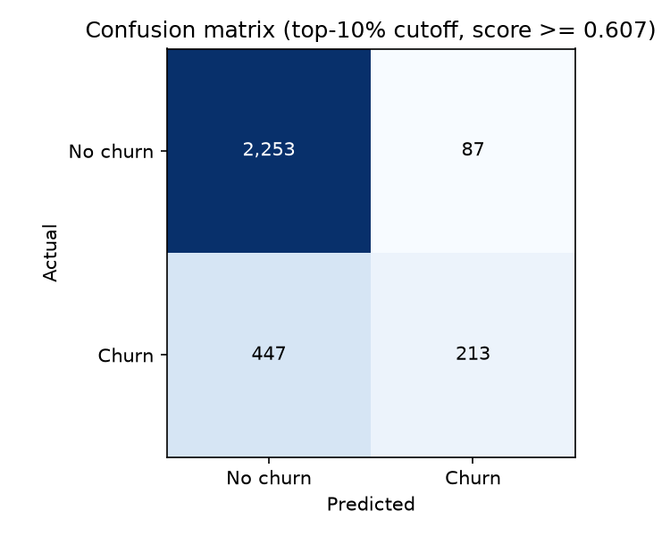
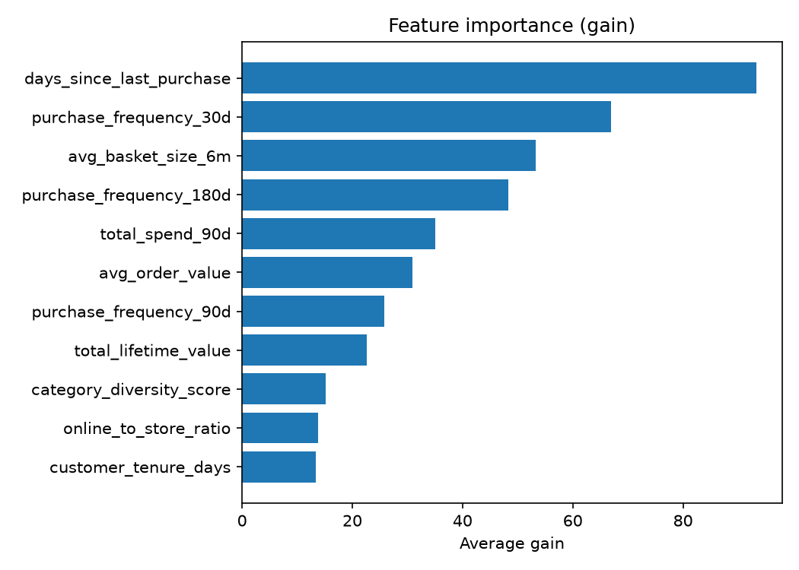

# Lab 3 Evaluation Report: NorthStar Churn Model (Task 1)

**Graded run:** `xgb-final-shallow-slow` (see `lab3-evidence/train-final.log`).
**Software:** trained locally on **XGBoost 3.4.1**. The SageMaker training container ships XGBoost 1.7, so numbers from a SageMaker job would differ slightly. Not compared here.
**Data and split:** 9,999 customers, 22.0% churn. Stratified 70/30 split, `seed=42`: 6,999 train / 3,000 test (660 positives in test).
**Hyperparameters (graded run):** `max_depth=4`, `eta=0.05`, `min_child_weight=5`, `subsample=0.8`, `colsample_bytree=0.8`, `scale_pos_weight=3.5448` (negatives / positives in the training split, so each churner counts about 3.5x and the model cannot score well by predicting 'no churn' for everyone), `num_round=400` maximum; early stopping (20 rounds) halted training at round 56. `churn_risk_score` excluded.

## 1. Results (test set)

| Metric | Value | Threshold |
|---|---|---|
| AUC-ROC | 0.7820 | report only |
| Precision @ top 10% | 0.7100 | >= 0.50 (met) |
| Recall @ top 10% | 0.3227 | >= 0.25 (met) |
| Recency-only baseline AUC | 0.7232 | n/a |
| AUC lift over baseline | +0.0587 | 95% CI must exclude 0 |
| Lift 95% CI | [0.0408, 0.0776] | excludes 0 (met) |

The CI is a paired bootstrap on the test set: 2,000 resamples of rows, both models scored on the same resampled rows each time, 2.5th and 97.5th percentiles of the AUC difference. The baseline is an XGBoost model trained on `days_since_last_purchase` alone.

Confusion matrix at the top-10% score cutoff (300 customers flagged):

## 2. Experiment tracking (MLflow App `northstar-mlflow`)

Five runs in experiment `northstar-churn` (full export in `lab3-evidence/mlflow-runs.csv`):

| Run | Config | AUC |
|---|---|---|
| xgb-baseline-norisk | defaults, no risk score | 0.7764 |
| xgb-with-risk | defaults + `churn_risk_score` | 0.7805 |
| xgb-shallow-slow | depth 4, eta 0.05, num_round=400 maximum; early stopping (20 rounds) halted training at round 56 | 0.7820 |
| xgb-deep-reg | depth 8, min_child_weight 10 | 0.7760 |
| xgb-final-shallow-slow (graded) | same as shallow-slow, registered | 0.7820 |

**Caveats.** I chose the final configuration by test-set AUC, and early stopping (20 rounds, halted at round 56) monitored the same 3,000 held-out rows that are scored, so the reported metrics are slightly optimistic. The four configurations differ by only 0.776 to 0.782 AUC, within split-to-split noise.

**Risk score.** `churn_risk_score` is a recency heuristic; adding it at default hyperparameters moved AUC from 0.7764 to 0.7805 (+0.0041) and precision@10% from 0.690 to 0.703, which is small. The graded model excludes it.

## 3. Slice evaluation by loyalty tier

Source: `lab3-evidence/slice-evaluation.csv`. Recall uses the same global top-10% cutoff as the aggregate metric (aggregate recall 0.3227). A slice is `too_small` if n < 100 or positives < 30.

| Tier | n | Positives | Churn rate | AUC | Recall @ global top 10% | Too small? |
|---|---|---|---|---|---|---|
| Bronze | 1,071 | 361 | 33.7% | 0.7499 | 0.4571 | no |
| Silver | 1,139 | 226 | 19.8% | 0.7202 | 0.1770 | no |
| Gold | 483 | 52 | 10.8% | 0.7502 | 0.1154 | no |
| Platinum | 307 | 21 | 6.8% | 0.8874 | 0.0952 | **yes** |

**Weakest tier: Silver.** It has the lowest AUC (0.720) with 1,139 customers and 226 churners, enough to trust. Its AUC was also the lowest of the four tiers in every run I did (0.696 to 0.720) (exploratory-runs/run1.log to run4.log).

Recall uses one global cutoff, so low-churn tiers (Gold, Platinum) look worse by construction.

**Platinum is too small to conclude from.** 21 test-set churners means moving a single customer shifts recall by about 0.048; in my exploratory runs Platinum recall swung between 0.095 and 0.19 (2 vs 4 customers) while AUC stayed between 0.877 and 0.887 (exploratory-runs/run1.log to run4.log). Its AUC looks like the strongest tier, but I do not draw a conclusion from either metric.

## 4. Feature importance

The top features by gain are days_since_last_purchase, purchase_frequency_30d and avg_basket_size_6m; the lowest are category_diversity_score, online_to_store_ratio and customer_tenure_days.
